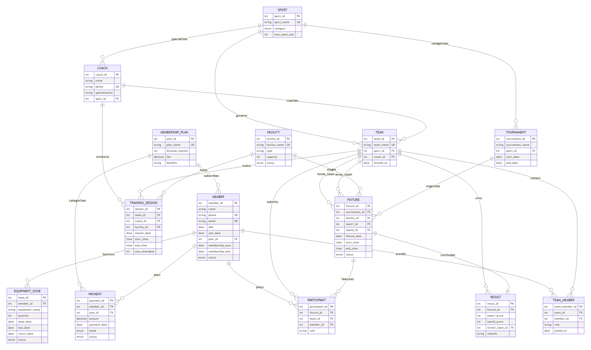
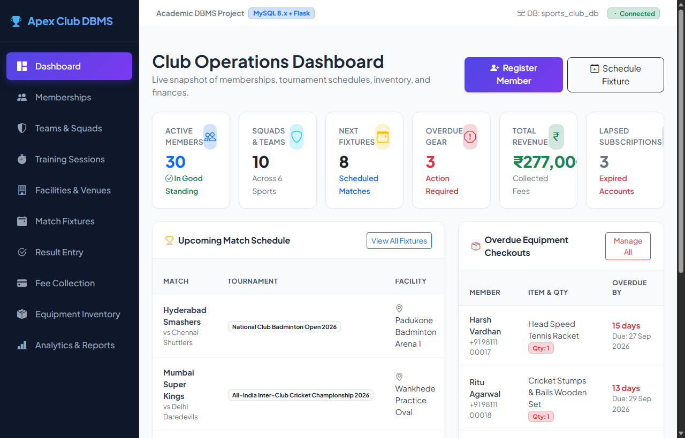
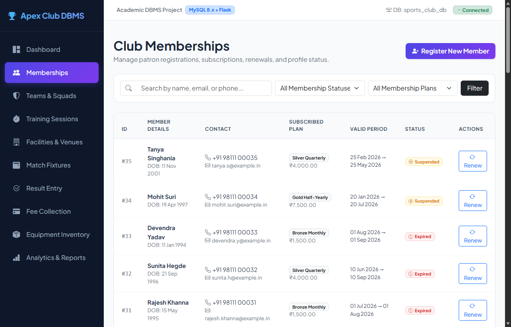
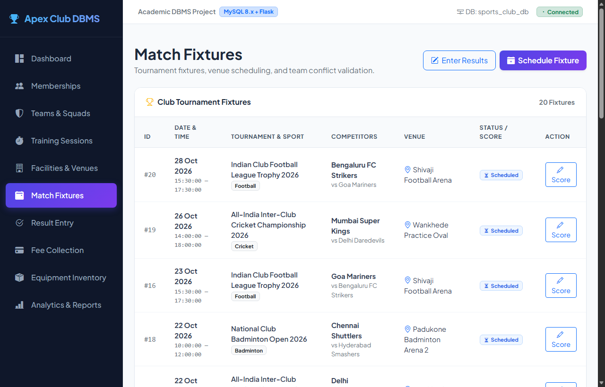
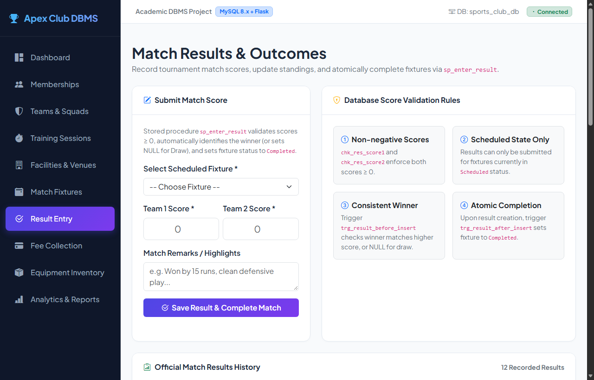

# Sports Club Membership and Tournament Management DBMS

<div align="center">


-brightgreen?logo=pytest&logoColor=white)


**A Production-Ready, ACID-Compliant Relational Database Management System & Full-Stack Web Application**

*Developed for the Project-Based Learning (PBL) Component of Database Management Systems (DBMS)*

---

**Author:** Prabheesh Singh  
**Roll Number:** `WOU0102211`  
**Program:** B.Tech. Computer Science & Engineering  
**Section:** CSE – AI/ML Leopards  
**Institution:** School of Technology, Woxsen University  
**Academic Year:** 2026 – 2027  
**GitHub Repository:** [https://github.com/Prabheesh178/dbms-2211](https://github.com/Prabheesh178/dbms-2211)

</div>

---

## 📑 Table of Contents

- [1. Executive Summary & Deep Project Overview](#1-executive-summary--deep-project-overview)
- [2. System Architecture & Directory Structure](#2-system-architecture--directory-structure)
- [3. Relational Database Design](#3-relational-database-design)
  - [3.1 Entity-Relationship (ER) Diagram](#31-entity-relationship-er-diagram)
  - [3.2 14-Table Normalized Relational Schema](#32-14-table-normalized-relational-schema)
  - [3.3 Normalization Justification (1NF → 2NF → 3NF/BCNF)](#33-normalization-justification-1nf--2nf--3nf-bcnf)
- [4. Declarative Business Rules, Triggers & Stored Procedures](#4-declarative-business-rules-triggers--stored-procedures)
  - [4.1 Database Triggers (Declarative Integrity)](#41-database-triggers-declarative-integrity)
  - [4.2 Transactional Stored Procedures (ACID Guarantees)](#42-transactional-stored-procedures-acid-guarantees)
- [5. Full-Stack Web Application Modules](#5-full-stack-web-application-modules)
- [6. Visual Showcase & Interface Screenshots](#6-visual-showcase--interface-screenshots)
- [7. Step-by-Step Guide: How to Run the Project](#7-step-by-step-guide-how-to-run-the-project)
  - [7.1 Prerequisites](#71-prerequisites)
  - [7.2 Clone the Repository](#72-clone-the-repository)
  - [7.3 MySQL Database Setup](#73-mysql-database-setup)
  - [7.4 Execute SQL Scripts in Numerical Order](#74-execute-sql-scripts-in-numerical-order)
  - [7.5 Python Environment & Dependencies](#75-python-environment--dependencies)
  - [7.6 Environment Configuration (.env)](#76-environment-configuration-env)
  - [7.7 Start the Flask Web Application](#77-start-the-flask-web-application)
- [8. Automated Testing & Verification](#8-automated-testing--verification)
  - [8.1 SQL Constraint & Trigger Test Harness (26 Tests)](#81-sql-constraint--trigger-test-harness-26-tests)
  - [8.2 Python Pytest Test Suite (21 Tests)](#82-python-pytest-test-suite-21-tests)
- [9. Analytical Views & Real-Time Reporting](#9-analytical-views--real-time-reporting)
- [10. Academic Deliverables & Documentation Index](#10-academic-deliverables--documentation-index)

---

## 1. Executive Summary & Deep Project Overview

### 1.1 The Real-World Problem
Modern athletic academies, university sports complexes, and private athletic clubs operate high-frequency, interconnected workflows daily. They juggle multiple subscriber tiers, coaching assignments, competitive squad rosters, practice sessions, multi-facility scheduling (cricket pitches, football grounds, indoor badminton courts, swimming facilities), tournament championships, match result recording, fee collection ledgers, and sports gear equipment custody.

Traditionally, these establishments rely on fragmented spreadsheets, isolated logbooks, or superficial CRUD apps. This disconnected approach leads to catastrophic operational failures:
1. **Facility Double-Booking:** Overlapping training drills and competitive tournament fixtures scheduled on the exact same court simultaneously.
2. **Squad Schedule Collisions:** Squads scheduled to contest matches or attend coaching sessions simultaneously in different venues.
3. **Ghost & Expired Memberships:** Expired or suspended patrons participating in team rosters, consuming club assets, or borrowing sports equipment without paying dues.
4. **Unenforced Safety & Roster Caps:** Rosters exceeding sporting regulatory squad limits, or drills exceeding venue safety capacities.
5. **Score & Winner Incoherence:** Manual record errors where losing teams are declared winners or negative scores are entered.
6. **Equipment Loss & Unchecked Loans:** Sports gear checked out without loan limits, missing overdue alarms, and leading to heavy unrecoverable inventory losses.
7. **Disputed Tournament Standings:** Human calculation errors in league tables (points, goal difference, win/draw/loss counts).

### 1.2 The Engineered Solution
This project delivers a **dual-tier, enterprise-grade Database Management System**:
- **Database Engine Tier (MySQL 8.x):** Instead of trusting client-side frontend checks (which can be bypassed via direct database connections, network delays, or concurrency race conditions), **all core business rules and integrity policies are enforced directly at the database engine level**. This is achieved using strict InnoDB table constraints, 8 active MySQL triggers (`SIGNAL SQLSTATE '45000'`), and 6 ACID-compliant stored procedures (`START TRANSACTION`, `COMMIT`, `ROLLBACK`).
- **Application & Presentation Tier (Python Flask + Bootstrap 5):** A responsive, secure administrative web application featuring connection pooling, parameterized SQL queries, interactive slot availability diagnostics, CSV stream serialization, and automated report generation.

---

## 2. System Architecture & Directory Structure

```
dbms-2211/
├── DBMS_PBL_Report Prabheesh Singh.docx  # Official Academic PBL Report (Word Document)
├── DBMS_PBL_Report Prabheesh Singh.md    # Complete Markdown Report with full text & tables
├── Prabheesh Singh.pptx                  # Academic Project Presentation Slides
├── README.md                             # Comprehensive Project Documentation (This File)
├── .gitignore                            # Excludes MySQL binaries, cache, and local secrets
│
└── sports_club_dbms/
    ├── requirements.txt                  # Python dependencies (Flask, mysql-connector, pytest, etc.)
    ├── .env.example                      # Template for database configuration credentials
    ├── .env                              # Local configuration (ignored from git)
    ├── README.md                         # Inner package overview
    │
    ├── sql/                              # Core MySQL 8.x Database Engine Scripts
    │   ├── 01_schema.sql                 # 14 normalized tables, PKs, FKs, CHECKs, 8 B-Tree indexes
    │   ├── 02_triggers.sql               # 8 business rule triggers (cross-table collisions, quotas)
    │   ├── 03_procedures.sql             # 6 transactional stored procedures & maintenance events
    │   ├── 04_sample_data.sql            # Realistic Indian athletic club dataset satisfying all constraints
    │   ├── 05_queries.sql                # 27 analytical queries (joins, aggregations, subqueries)
    │   └── 06_views.sql                  # 8 live operational and analytical database views
    │
    ├── app/                              # Full-Stack Flask Web Application
    │   ├── app.py                        # Controller routes, API handlers, and CSV streaming
    │   ├── db.py                         # MySQL connection pooling & exception sanitization
    │   ├── validators.py                 # Strict server-side validation routines
    │   ├── static/
    │   │   ├── css/style.css             # Custom glassmorphic dark theme styling
    │   │   └── js/main.js                # AJAX slot availability checker & dynamic UI
    │   └── templates/                    # Jinja2 Modular HTML5 Templates
    │       ├── base.html                 # Master layout (sidebar, navbar, alerts)
    │       ├── index.html                # Module 1: Dashboard & metrics hub
    │       ├── members.html              # Module 2: Member directory & modal
    │       ├── member_renew.html         # Module 2: Renewal workflow form
    │       ├── teams.html                # Module 3: Team formation catalog
    │       ├── team_detail.html          # Module 3: Squad roster manager
    │       ├── training.html             # Module 4: Training session scheduler
    │       ├── facility_booking.html     # Module 5: Facilities & live conflict checker
    │       ├── fixtures.html             # Module 6: Tournament match fixtures
    │       ├── results.html              # Module 7: Score entry & winner validator
    │       ├── payments.html             # Module 8: Financial payment ledger
    │       ├── equipment.html            # Module 9: Equipment checkout & returns
    │       └── reports.html              # Module 10: Dynamic view explorer & CSV export
    │
    ├── tests/                            # Automated Quality Assurance Suites
    │   ├── test_constraints.sql          # 26 automated SQL tests (13 Fail + 13 Pass assertions)
    │   └── test_app.py                   # 21 pytest integration & route tests
    │
    └── docs/                             # Academic Engineering Documentation
        ├── build_pbl_report_docx.py      # Automated report compiler script
        ├── er_diagram.mmd                # Mermaid ER diagram source
        ├── erd.html                      # Standalone interactive ER diagram renderer
        ├── normalization.md              # Mathematical functional dependency & 3NF proofs
        ├── test_report.md                # Complete verification matrix (100% PASS)
        ├── fig1_er_diagram.png           # High-resolution ER diagram
        ├── fig2_dashboard.png            # Live Dashboard interface screenshot
        ├── fig3_members.png              # Live Member management interface screenshot
        ├── fig4_fixtures.png             # Live Fixtures & Conflict checker interface screenshot
        └── fig5_results.png              # Live Results & Standings interface screenshot
```

---

## 3. Relational Database Design

### 3.1 Entity-Relationship (ER) Diagram
The conceptual data model incorporates **14 strongly-typed relational entities** designed using Crow's Foot notation. It connects patrons, subscriptions, athletic disciplines, coaches, team rosters, physical facilities, training drills, tournaments, match fixtures, lineups, outcomes, and inventory assets.

<div align="center">



*Figure 1: Complete Crow's Foot Entity-Relationship Diagram of the Sports Club DBMS*

</div>

---

### 3.2 14-Table Normalized Relational Schema

| S.No. | Table Name | Primary Key | Key Foreign Keys | Purpose & Business Responsibility |
| :---: | :--- | :--- | :--- | :--- |
| **1** | `membership_plan` | `plan_id` | — | Subscription tiers (Monthly, Quarterly, Annual, VIP), validity months, and pricing. |
| **2** | `member` | `member_id` | `plan_id` (`RESTRICT`) | Club patron profiles, contact channels, membership validity windows, account status. |
| **3** | `payment` | `payment_id` | `member_id`, `plan_id` (`RESTRICT`) | Financial receipt audit ledger tracking remittance amounts, channels (UPI, Cash, Card), and status. |
| **4** | `sport` | `sport_id` | — | Sporting disciplines (Cricket, Football, Badminton, etc.), category, max squad size. |
| **5** | `coach` | `coach_id` | `sport_id` (`RESTRICT`) | Certified coaching personnel, contact numbers, tactical specializations. |
| **6** | `team` | `team_id` | `sport_id` (`RESTRICT`), `coach_id` (`SET NULL`) | Club athletic squads affiliated with a sport and appointed head coach. |
| **7** | `team_member` | `team_member_id`| `team_id` (`CASCADE`), `member_id` (`RESTRICT`) | Associative M:N entity linking active members to squads with assigned roles. |
| **8** | `facility` | `facility_id` | — | Physical club venue assets (courts, grounds, turfs), spectator/player capacities, maintenance state. |
| **9** | `training_session`| `session_id` | `team_id`, `coach_id`, `facility_id` (`RESTRICT`) | Scheduled team practice drills reserving a facility and coach at defined time windows. |
| **10**| `tournament` | `tournament_id` | `sport_id` (`RESTRICT`) | Master competitive championships and seasonal leagues organized by the club. |
| **11**| `fixture` | `fixture_id` | `tournament_id` (`CASCADE`), `facility_id`, `team1_id`, `team2_id` (`RESTRICT`) | Competitive head-to-head match encounters between two distinct squads. |
| **12**| `participant` | `participant_id`| `fixture_id` (`CASCADE`), `team_id`, `member_id` (`RESTRICT`) | Official submitted player lineups and starting rosters for a specific fixture. |
| **13**| `result` | `result_id` | `fixture_id` (`CASCADE`, UNIQUE), `winner_team_id` (`RESTRICT`) | 1:1 post-match outcome record storing final scores, winner, and official match notes. |
| **14**| `equipment_issue`| `issue_id` | `member_id` (`RESTRICT`) | Sports gear inventory checkout tracking, return deadlines, and custody statuses. |

---

### 3.3 Normalization Justification (1NF → 2NF → 3NF/BCNF)

The schema was systematically evaluated against formal database normalization criteria:
- **1NF (First Normal Form):** All attribute values are strictly atomic (no repeating groups or comma-separated lists). Multi-valued attributes (e.g., equipment checkouts, roster members) are segregated into dedicated relational entities with unique surrogate primary keys.
- **2NF (Second Normal Form):** In all composite candidate key tables (`team_member`, `participant`), every non-prime attribute functionally depends on the entire candidate key, completely eliminating partial dependencies.
- **3NF & BCNF (Third Normal Form / Boyce-Codd Normal Form):** For every non-trivial functional dependency $X \rightarrow Y$, the determinant $X$ is a superkey. There are no transitive dependencies between non-prime attributes. Dynamic calculations (such as tournament points, goal differences, overdue statuses, and fee dues) are computed on-the-fly via SQL views rather than stored as redundant mutable columns.

*(For the complete mathematical proofs and functional dependency sets $FD_1 - FD_{24}$, see [`docs/normalization.md`](sports_club_dbms/docs/normalization.md).)*

---

## 4. Declarative Business Rules, Triggers & Stored Procedures

### 4.1 Database Triggers (Declarative Integrity)

The database engine enforces 8 critical operational rules directly within the MySQL InnoDB storage engine:

| Trigger Name | Target Table | Timing | Enforced Business Rule |
| :--- | :--- | :--- | :--- |
| `trg_training_session_facility_overlap` | `training_session` | BEFORE INSERT / UPDATE | Blocks booking a facility if an overlapping training session or match fixture already exists. |
| `trg_fixture_facility_overlap` | `fixture` | BEFORE INSERT / UPDATE | Prevents staging a match if the venue is already occupied by a drill or another fixture. |
| `trg_team_schedule_collision` | `training_session` & `fixture` | BEFORE INSERT / UPDATE | Blocks scheduling a squad for two events simultaneously across disparate venues. |
| `trg_active_member_roster_check` | `team_member` | BEFORE INSERT | Verifies that a patron is `Active` and has a non-expired subscription before joining a team. |
| `trg_roster_capacity_ceiling` | `team_member` | BEFORE INSERT | Enforces that team roster size cannot exceed `sport.max_team_size`. |
| `trg_result_score_winner_check` | `result` | BEFORE INSERT / UPDATE | Rejects negative scores; ensures `winner_team_id` strictly matches the higher scoring team, or is `NULL` for draws. |
| `trg_equipment_issue_quota` | `equipment_issue` | BEFORE INSERT | Restricts members to a maximum of 3 concurrent unreturned items; prohibits loans if any item is overdue. |
| `trg_facility_maintenance_check` | `training_session` & `fixture` | BEFORE INSERT | Prohibits scheduling any activity on facilities whose status is `Maintenance`. |

---

### 4.2 Transactional Stored Procedures (ACID Guarantees)

Complex, multi-table business operations are wrapped inside stored procedures featuring explicit `START TRANSACTION`, `COMMIT`, and `ROLLBACK` blocks:

1. **`sp_register_member_with_payment`**: Atomically creates a member profile, calculates the active subscription expiration date based on plan duration, and records the initial fee receipt in `payment`. If any step fails, the entire transaction rolls back.
2. **`sp_renew_membership`**: Extends a patron's validity window from either their current expiration date or today's date, updates account status to `Active`, and logs a renewal payment receipt atomically.
3. **`sp_enter_result`**: Submits match scores, validates the winner, inserts the `result` record, and automatically transitions the parent `fixture` status from `Scheduled` to `Completed`.
4. **`sp_issue_equipment`**: Verifies member eligibility, checks borrowing quotas, and records gear checkout with calculated return deadlines.
5. **`sp_return_equipment`**: Finalizes equipment return, timestamps `return_date`, and updates status to `Returned`.
6. **`sp_maintenance_check`**: Scheduled maintenance routine that automatically flags memberships past their end date as `Expired` and loans past their due date as `Overdue`.

---

## 5. Full-Stack Web Application Modules

The application is engineered with Python 3.10+, Flask, Jinja2, and Bootstrap 5 CDN, structured into **10 administrative modules**:

| Module | Route | Key Capabilities & Operations |
| :--- | :--- | :--- |
| **1. Dashboard** | `/` | Operational command center with real-time stat cards (members, squads, upcoming fixtures, revenue), match calendar, and overdue gear alerts. |
| **2. Memberships** | `/members` | Member directory with live search filtering, plan tier dropdown, renewal form, and an atomic registration modal calling `sp_register_member_with_payment`. |
| **3. Team Rosters** | `/teams` | Team creation catalog, sport and coach alignment, squad capacity progress meters, and player roster enrollment/removal. |
| **4. Training Scheduling** | `/training` | Practice session scheduler with coach and facility reservations protected against overlaps. |
| **5. Facilities & Booking** | `/facilities` | Physical venue catalog with an **interactive AJAX slot availability diagnostic tool** that detects cross-table collisions before booking. |
| **6. Match Fixtures** | `/fixtures` | Championship fixture scheduling between distinct squads with automatic sport validation. |
| **7. Result Entry** | `/results` | Match score submission form enforcing winner-score consistency and auto-completing fixtures via `sp_enter_result`. |
| **8. Fee Collection** | `/payments` | Financial audit ledger filtering transactions across channels (UPI, Cash, Card, Bank) and statuses (Paid vs. Pending). |
| **9. Equipment Inventory**| `/equipment` | Gear loan checkout desk enforcing 3-item quotas, overdue tracking, and return processing. |
| **10. Analytics & Reports**| `/reports` | Live tabbed reporting portal executing all 8 database views with instant one-click CSV export streaming. |

---

## 6. Visual Showcase & Interface Screenshots

### Figure 2: Operational Dashboard & Metrics Hub
Real-time summary cards displaying active patron counts, registered squads, upcoming matches, overdue loans, revenue metrics, and fixture schedules.


---

### Figure 3: Member Directory & Registration Modal
Searchable patron directory with status filters and modal dialog executing atomic registration with automated subscription date calculation.


---

### Figure 4: Match Fixture Scheduling & Live Conflict Checker
Interactive venue slot availability diagnostic tool testing proposed dates and times against existing practice drills and fixtures.


---

### Figure 5: Match Results Entry & Live Tournament Standings
Score entry module enforcing winner validation, automatic fixture completion, and live generation of championship standings.


---

## 7. Step-by-Step Guide: How to Run the Project

Follow these instructions to set up and run the entire system locally from scratch.

### 7.1 Prerequisites
Ensure the following tools are installed on your machine:
- **Python 3.10+ or 3.11+** ([python.org](https://www.python.org/downloads/))
- **MySQL Community Server 8.0+** ([dev.mysql.com](https://dev.mysql.com/downloads/installer/))
- **Git** ([git-scm.com](https://git-scm.com/))

---

### 7.2 Clone the Repository
Clone the repository to your local system:
```bash
git clone https://github.com/Prabheesh178/dbms-2211.git
cd dbms-2211
```

---

### 7.3 MySQL Database Setup
Open your MySQL terminal or MySQL Workbench as `root`:

```sql
-- 1. Create the database with UTF-8 Unicode support
CREATE DATABASE IF NOT EXISTS sports_club_db 
    CHARACTER SET utf8mb4 
    COLLATE utf8mb4_unicode_ci;

-- 2. Create dedicated user and grant full privileges
CREATE USER IF NOT EXISTS 'sports_user'@'localhost' IDENTIFIED BY 'sports_pass';
CREATE USER IF NOT EXISTS 'sports_user'@'%' IDENTIFIED BY 'sports_pass';
GRANT ALL PRIVILEGES ON sports_club_db.* TO 'sports_user'@'localhost', 'sports_user'@'%';

-- 3. Enable stored functions/triggers & apply privileges
SET GLOBAL log_bin_trust_function_creators = 1;
FLUSH PRIVILEGES;
```

---

### 7.4 Execute SQL Scripts in Numerical Order
Navigate into the `sports_club_dbms` directory and execute all 6 SQL scripts in exact numerical order:

#### On Windows (PowerShell):
```powershell
cd sports_club_dbms
$files = @("01_schema.sql", "02_triggers.sql", "03_procedures.sql", "04_sample_data.sql", "05_queries.sql", "06_views.sql")
foreach ($f in $files) {
    Write-Host "Executing sql/$f..."
    mysql -h 127.0.0.1 -P 3306 -u sports_user -psports_pass sports_club_db -e "source sql/$f"
}
```
*(Note: If your MySQL server runs on port 3307, change `-P 3306` to `-P 3307`)*

#### On Linux / macOS (Bash):
```bash
cd sports_club_dbms
for f in 01_schema.sql 02_triggers.sql 03_procedures.sql 04_sample_data.sql 05_queries.sql 06_views.sql; do
    echo "Executing sql/$f..."
    mysql -h 127.0.0.1 -P 3306 -u sports_user -psports_pass sports_club_db < "sql/$f"
done
```

*All 6 SQL scripts will execute cleanly with zero errors!*

---

### 7.5 Python Environment & Dependencies
Create and activate an isolated Python virtual environment, then install dependencies:

```bash
# Create virtual environment
python -m venv venv

# Activate on Windows PowerShell:
.\venv\Scripts\Activate.ps1

# Activate on Linux / macOS:
source venv/bin/activate

# Install required Python packages
pip install -r requirements.txt
```

---

### 7.6 Environment Configuration (.env)
Create a `.env` file inside `sports_club_dbms/` (you can copy `.env.example`):

```ini
DB_HOST=127.0.0.1
DB_PORT=3306
DB_USER=sports_user
DB_PASSWORD=sports_pass
DB_NAME=sports_club_db
SECRET_KEY=sports_club_super_secret_key_2026
PORT=5000
```
*(Adjust `DB_PORT` to `3307` if your local MySQL runs on 3307).*

---

### 7.7 Start the Flask Web Application
Run the Flask server:

```bash
python app/app.py
```

The application will start immediately:
```
 * Serving Flask app 'app'
 * Debug mode: on
 * Running on http://127.0.0.1:5000
```

Open your browser and visit:  
👉 **[http://127.0.0.1:5000](http://127.0.0.1:5000)**

---

## 8. Automated Testing & Verification

The system includes a **comprehensive two-tier test suite** verifying both database engine integrity and web application controllers.

### 8.1 SQL Constraint & Trigger Test Harness (26 Tests)
Directly tests MySQL engine constraints and triggers with 13 negative (failing violation) and 13 positive (valid operation) assertions:

```bash
mysql -h 127.0.0.1 -P 3306 -u sports_user -psports_pass sports_club_db -e "source tests/test_constraints.sql"
```

**Output:**
```
+------------------------+--------------+--------------+------------------+
| total_tests_executed   | passed_tests | failed_tests | overall_verdict  |
+------------------------+--------------+--------------+------------------+
| 26                     | 26           | 0            | 100% PASS        |
+------------------------+--------------+--------------+------------------+
```

---

### 8.2 Python Pytest Test Suite (21 Tests)
Validates email, phone, date, and payload validators, HTTP routes, JSON APIs, and CSV downloads:

```bash
pytest tests/test_app.py -v
```

**Output:**
```
tests/test_app.py::TestValidators::test_email_validation PASSED          [  4%]
tests/test_app.py::TestValidators::test_phone_validation PASSED          [  9%]
tests/test_app.py::TestValidators::test_date_validation PASSED           [ 14%]
tests/test_app.py::TestValidators::test_date_range_validation PASSED     [ 19%]
tests/test_app.py::TestValidators::test_time_range_validation PASSED     [ 23%]
tests/test_app.py::TestValidators::test_positive_numbers PASSED          [ 28%]
tests/test_app.py::TestValidators::test_member_payload_validator PASSED  [ 33%]
tests/test_app.py::TestValidators::test_fixture_payload_validator PASSED [ 38%]
tests/test_app.py::TestFlaskRoutes::test_dashboard_route PASSED          [ 42%]
tests/test_app.py::TestFlaskRoutes::test_members_route PASSED            [ 47%]
tests/test_app.py::TestFlaskRoutes::test_teams_route PASSED              [ 52%]
tests/test_app.py::TestFlaskRoutes::test_team_detail_route PASSED        [ 57%]
tests/test_app.py::TestFlaskRoutes::test_training_route PASSED           [ 61%]
tests/test_app.py::TestFlaskRoutes::test_facilities_route PASSED         [ 66%]
tests/test_app.py::TestFlaskRoutes::test_facility_conflict_checker_api PASSED [ 71%]
tests/test_app.py::TestFlaskRoutes::test_fixtures_route PASSED           [ 76%]
tests/test_app.py::TestFlaskRoutes::test_results_route PASSED            [ 80%]
tests/test_app.py::TestFlaskRoutes::test_payments_route PASSED           [ 85%]
tests/test_app.py::TestFlaskRoutes::test_equipment_route PASSED          [ 90%]
tests/test_app.py::TestFlaskRoutes::test_reports_route PASSED            [ 95%]
tests/test_app.py::TestFlaskRoutes::test_reports_csv_export PASSED       [100%]

============================= 21 passed in 0.55s ==============================
```

---

## 9. Analytical Views & Real-Time Reporting

The system defines **8 live database views** accessible directly from the **Analytics & Reports** tab (`/reports`), featuring one-click CSV download:

1. **`v_active_memberships`**: Current active club members with temporal countdown `DATEDIFF(membership_end, CURDATE())`.
2. **`v_membership_expiring_30_days`**: Proactive renewal alerts filtering subscriptions expiring within the next 30 days.
3. **`v_fixture_schedule`**: Master tournament match calendar with venues, participating teams, kickoff times, scores, and match statuses.
4. **`v_tournament_standings`**: Dynamic championship league standings calculating matches played, wins, draws, losses, goals for (GF), goals against (GA), goal difference (GD), standard 3-1-0 tournament points, and rank using window functions.
5. **`v_facility_utilization`**: Venue utilization contrasting practice sessions versus tournament matches per facility.
6. **`v_player_performance`**: Match appearances, starter/substitute roles, and squad victory tallies per player.
7. **`v_fee_dues`**: Accounts receivable report highlighting patrons with unpaid fees or expired subscriptions.
8. **`v_equipment_status`**: Custody audit summary aggregating issued, returned, and overdue equipment items per member.

---

## 10. Academic Deliverables & Documentation Index

| Deliverable | File Path | Description |
| :--- | :--- | :--- |
| **Official Academic Report (Word)** | [`DBMS_PBL_Report Prabheesh Singh.docx`](DBMS_PBL_Report%20Prabheesh%20Singh.docx) | Full formal PBL report formatted to exact Woxsen University guidelines (Times New Roman, 1.5 line spacing, 1-inch margins, Tables 1–15, Figures 1–5). |
| **Complete Report (Markdown)** | [`DBMS_PBL_Report Prabheesh Singh.md`](DBMS_PBL_Report%20Prabheesh%20Singh.md) | Full text of all 4 chapters, data dictionary, SQL snippets, test cases, and IEEE citations. |
| **Presentation Slides** | [`Prabheesh Singh.pptx`](Prabheesh%20Singh.pptx) | PowerPoint presentation for project viva and academic review. |
| **Normalization Proofs** | [`sports_club_dbms/docs/normalization.md`](sports_club_dbms/docs/normalization.md) | Step-by-step mathematical proofs of 1NF → 2NF → 3NF/BCNF normalization. |
| **Test Verification Matrix** | [`sports_club_dbms/docs/test_report.md`](sports_club_dbms/docs/test_report.md) | Comprehensive test case matrix logging 100% pass outcomes. |
| **ER Diagram Source** | [`sports_club_dbms/docs/er_diagram.mmd`](sports_club_dbms/docs/er_diagram.mmd) | Raw Mermaid code for the 14-entity Crow's foot diagram. |
| **Report Compiler Script** | [`sports_club_dbms/docs/build_pbl_report_docx.py`](sports_club_dbms/docs/build_pbl_report_docx.py) | Python script that compiles the markdown source into a styled `.docx` document. |

---

<div align="center">

**School of Technology — Woxsen University**  
*Department of Computer Science & Engineering*  
October 2026

</div>
